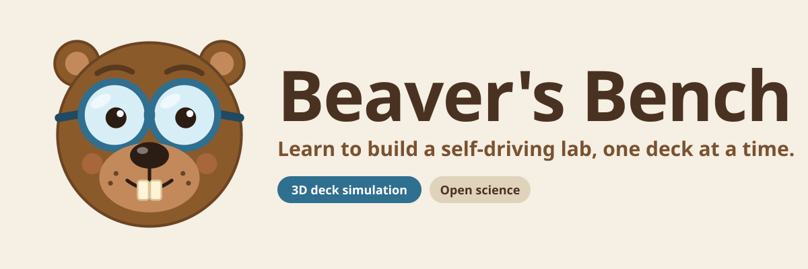
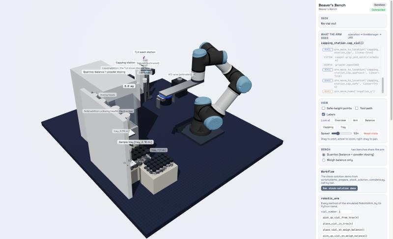

<p align="center">
  
</p>

# Beaver's Bench

A 3D simulation of the Hein lab's UR3e colour-match deck, for training. It takes the instrument calls
of the [colour-match SDL](https://gitlab.com/heingroup/colour-match-sdl) simulator
(`robotic_arm.pick_up_vial_from_tray(3)`, `capping_station.uncap_vial()`, …) and plays what the real
arm does for each: home, the safe point, the approach point above the target, straight down, gripper,
back out, on a UR3e model with inverse kinematics, next to a log that reads like the ArmManager code.
Locations come from the deck's own location file.



## Two ways to run it, one build

**Inside ivoryos-next**, as a panel beside the IvoryOS pages, driven by the Python simulator:

```bash
pip install -e .                      # pulls colour-match-sdl (the simulator and the plugin bridge)
pip install -e ../ivoryos-nextgen/edge_server   # or however ivoryos-next is installed for you
python examples/edge_app.py           # IVORYOS_PORT picks the port (default 8080)
```

Or add the plugin to any deck that uses the simulator: `plugins=[beavers_bench.next_plugin.plugin]`.

**From the IvoryOS desktop app**: in the launcher, add a profile of the kind *Python script*, choose
`examples/edge_app.py`, and set its Python to an environment where the two `pip install` lines
above have run (this repository's `.venv`, for example). Start it, open it, and Beaver's Bench is
in the sidebar as a panel. Use it instead of the colour-match *SDL Simulation* panel, not beside
it: both listen to the same simulator, and only the one that starts last receives its events.

**Standalone (sandbox)**: open the built page from any static file server and the simulator runs in
the page, with a button per instrument method and the stock-solution demo. No Python needed, so it
also embeds in the onboarding course.

```bash
python -m http.server -d beavers_bench/static
```

## The frontend

`frontend/` is the Vite + TypeScript + three.js source; `npm run build` there writes the page into
`beavers_bench/static/`, which this package ships (commit the result). [frontend/README.md](frontend/README.md)
explains the pieces, what comes from the location file (`frontend/deck/locations_education_deck.yaml`)
and what is estimated, and how to change the deck.

```bash
cd frontend
npm install
npm run dev      # http://localhost:5173, sandbox mode, hot reload
npm test         # kinematics against the URDF, IK round trips, the deck against the yaml
npm run build
```

## Tests

```bash
pip install -e .[test]
pytest           # the plugin served the way ivoryos-next serves it (skips without ivoryos_edge)
```
